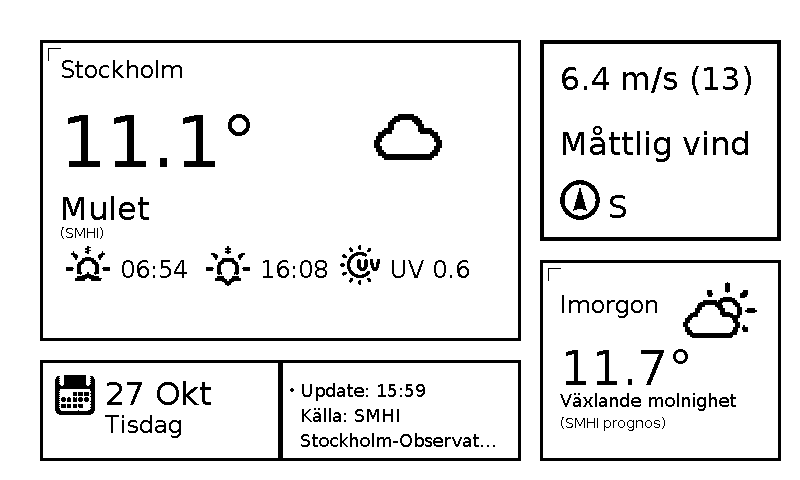

# paperweather-server


A small web server that draws a **weather dashboard as an 800×480 black-and-white image** and serves it over HTTP. It is designed for e-ink (e-paper) screens, which can only show black and white and refresh slowly, but any screen that can show an image works.

Everything you need is in this repository. It runs on a NAS or any Docker host — **no Raspberry Pi, no special display hardware, no API keys and no home weather station required**.



The image shows:

- **Current weather** for your location: temperature, a weather symbol and description (e.g. "Mulet" = overcast), sunrise and sunset, and UV index.
- **Wind**: average speed in m/s with gusts in parentheses, a description (e.g. "Måttlig vind" = moderate breeze) and the direction.
- **Tomorrow**: forecast temperature and weather.
- **Date** and a **status box** with the time of the last update and the data source.

Text on the image is in **Swedish only**, and the default data source covers **Sweden only** (see [Data sources](#data-sources)). The image is redrawn every 10 minutes.

Use it for:

- e-ink or other small displays (for example ESP32-based) that download a PNG on a schedule,
- a wall tablet or phone browser in landscape,
- anything that can show an image from a URL.

> **License:** public domain via [The Unlicense](LICENSE) — use, copy, modify and sell freely, no attribution required. Bundled third-party material keeps its own license: Weather Icons (SIL OFL 1.1 / MIT, see `weather-icons-master/README.md`) and the DejaVu Sans font (Bitstream Vera license).

## Data sources

| Source | What | Key needed | Coverage |
|--------|------|-----------|----------|
| [SMHI](https://www.smhi.se) (Swedish Meteorological and Hydrological Institute) | Forecast and recent observations | No | Sweden (default) |
| [Yr / MET Norway](https://api.met.no) | Forecast (alternative to SMHI) | No | Worldwide |
| [currentuvindex.com](https://currentuvindex.com) | UV index | No | Worldwide |
| Calculated locally | Sunrise and sunset (NOAA algorithm, accurate to about a minute) | No | Worldwide |
| [Netatmo](https://www.netatmo.com) *(optional)* | Readings from your own Netatmo home weather station | Yes, your own | Where you have one |
| [ipgeolocation.io](https://ipgeolocation.io) *(optional)* | Sun times from an API instead of the local calculation | Yes | Worldwide |

Outside Sweden, set the provider to `yr`. Some features (the "has it rained in the last hour" check against observation stations) only work in Sweden.

## Endpoints

| Path | Description |
|------|-------------|
| `/` | HTML page showing the image (auto-refreshing, tap to refresh) |
| `/weather.png` | The 800×480 PNG |
| `/api/weather` | Current weather data as JSON |
| `/api/refresh` | `POST` — force a data refresh and re-render |

Default port: **8037**.

## Install on Synology (Container Manager)

Requires DSM 7.2+ and the **Container Manager** package (available on Synology models with an x86 or ARM64 CPU; check *Package Center*). These steps are written so you can follow them yourself or hand them to an AI assistant.

1. **Create a folder** on the NAS, e.g. `/docker/paperweather-server`, using File Station.
2. **Get the project into that folder.** Either download this repository as a ZIP (*Code* → *Download ZIP* on GitHub) and extract it there, or `git clone` it over SSH. The folder must contain `Dockerfile`, `compose.yaml`, `main_web.py`, `modules/`, `templates/`, `fonts/` and `icons/`.
3. **Create your config.** Copy `config.example.json` to `config.json` in the same folder (File Station: copy and rename). Edit it:
   - `location`: your place name, latitude and longitude (see [Configuration](#configuration)).
   - `smhi_observations`: your nearest SMHI station (see `smhi_stationer.md`).
   - Leave `api_keys` empty — no keys are needed.
4. **Create the project.** Container Manager → *Project* → *Create*:
   - Project name: `paperweather-server`
   - Path: the folder from step 1
   - Source: *Use existing docker-compose.yml* (it detects `compose.yaml`; if the wizard insists on that name, rename the file to `docker-compose.yml`).
5. Click through the wizard and **build/start** the project. The first build downloads Python and the dependencies and takes a few minutes.
6. **Check it works.** Open `http://<nas-ip>:8037/` in a browser — you should see the weather image within about 10–20 seconds of start. `http://<nas-ip>:8037/weather.png` is the raw image.
7. **Firewall (if enabled):** allow TCP 8037 from your local network only. Do not expose this port to the internet.

If something fails, open the container's *Log* tab in Container Manager. A missing or invalid `config.json` is the most common cause (the file must exist before the container starts, otherwise Docker creates a directory with that name — delete it and create the file).

Plain Docker works the same way: `docker compose up -d --build` in the project folder.

> The Synology steps follow Container Manager's project wizard but have not yet been tested on every DSM version. If a step differs on your NAS, please open an issue.

### What the compose file does

- Publishes port `8037`.
- Mounts `./config.json` read-only at `/app/config.json`.
- Keeps cache and logs in the named volume `paperweather-data` (mounted at `/data`).
- Sets `TZ=Europe/Stockholm` (clock, date and sunrise/sunset use this) and `restart: unless-stopped`.
- Runs as a non-root user.

Change `TZ` in `compose.yaml` if you live in another time zone (e.g. `Europe/Oslo`, `America/New_York`).

## Configuration

Everything is in `config.json` (start from `config.example.json`; keys starting with `_comment` are notes and ignored). Restart the container after editing it.

- **Location** (`location`): name shown on the display, `latitude`, `longitude` in decimal degrees (look up your place on a map; negative values = south/west). Sunrise and sunset are calculated from these.
- **Provider** (`weather_provider`): `smhi` for Sweden (default, best tested) or `yr` for anywhere in the world.
- **SMHI observation station** (`smhi_observations`): used for "has it rained in the last hour?" and shown in the status box. Pick the nearest station from `smhi_stationer.md` (a list of station ids for larger Swedish cities, in Swedish) or follow `smhi_stationer_instruktion.md` (also in Swedish) to find one anywhere in Sweden. Set `primary_station_id`/`primary_station_name` and a backup in `fallback_station_*`. Outside Sweden, leave the example values.
- **Netatmo (optional)**: only if you own a Netatmo weather station. Create an app at <https://dev.netatmo.com>, then generate a token with the `read_station` scope in the app's token generator, and fill `client_id`, `client_secret` and `refresh_token` under `api_keys.netatmo`. Temperature, pressure and rain then come from your own station and the status box shows its battery levels. Leave all three empty to disable Netatmo.
- **ipgeolocation.io (optional)**: put a key in `api_keys.ipgeolocation` to fetch sun times from that API. Not needed — without it, sun times are calculated locally.
- **Layout, modules, triggers**: control which boxes are shown and when (e.g. a precipitation box replaces the wind box when rain is expected). Leave as is unless you want to experiment.

Keep `config.json` private if you add keys — it is excluded from git and from the Docker image.

## Updating

```bash
cd /path/to/paperweather-server
git pull            # or replace the folder contents with a new ZIP; keep your config.json
docker compose up -d --build
```

On Synology: Container Manager → Project → select the project → *Action* → *Build*, then start. Your `config.json` and the data volume are kept.

## Running without Docker

```bash
python3 -m venv .venv && . .venv/bin/activate
pip install -r requirements.txt
cp config.example.json config.json   # edit
python main_web.py                    # http://localhost:8037
```

Cache and logs go to `./cache` and `./logs` relative to where you start it.

## Origin

The dashboard layout was first made for a physical weather display — a Raspberry Pi with a 4.26" Waveshare e-paper screen — in the author's private project `eink_weather_2`. That project also has a web version that draws the same picture; **paperweather-server is a standalone, public copy of that web version**, packaged for Docker. You do not need the original project for anything. Maintainer notes on how the two are kept in sync are in [UPSTREAM.md](UPSTREAM.md).

Bugs and questions: open an issue in this repository.
